  

**Uczę się bronić sieci i systemów, a każdy krok dokumentuję w projektach.**

<picture>
  <source media="(prefers-color-scheme: dark)" srcset="assets/status-dark.svg">
  
</picture>

## O mnie

Studiuję informatykę w Collegium Da Vinci w Poznaniu. Uczę się sieci komputerowych, Linuxa i Pythona, a celem jest praca w cyberbezpieczeństwie. Teraz buduję pierwsze projekty z bezpieczeństwa.

## Czego się uczę

| Obszar | Zakres |
|---|---|
| **Sieci** | OSI / TCP-IP, adresacja i podsieci, DNS, DHCP, routing, analiza ruchu |
| **Linux** | terminal, uprawnienia, procesy i usługi, Bash |
| **Python** | automatyzacja, skrypty narzędziowe, praca z API |
| **Security** | bezpieczeństwo sieci, hardening systemów, narzędzia do analizy |

## Certyfikaty i kursy

<!--
Dodaj wiersz do tabeli dla każdego certyfikatu lub kursu, np.:
| Nazwa kursu | Wydawca | ukończony | 2026 |
-->
| Certyfikat / kurs | Wydawca | Status | Rok |
|---|---|---|---|
| Pierwsze certyfikaty są w przygotowaniu | — | — | — |

## Projekty

<!-- PROJECTS:START -->
Pierwsze projekty z cyberbezpieczeństwa są w przygotowaniu.
<!-- PROJECTS:END -->

## Aktywność

<picture>
  <source media="(prefers-color-scheme: dark)" srcset="assets/activity-dark.svg">
  
</picture>

## Kontakt

<a href="mailto:robertbudnik30@gmail.com">
  <picture>
    <source media="(prefers-color-scheme: dark)" srcset="assets/contact-dark.svg">
    
  </picture>
</a>

[Instagram](https://instagram.com/Budnik.jr_) · [E-mail](mailto:robertbudnik30@gmail.com)
